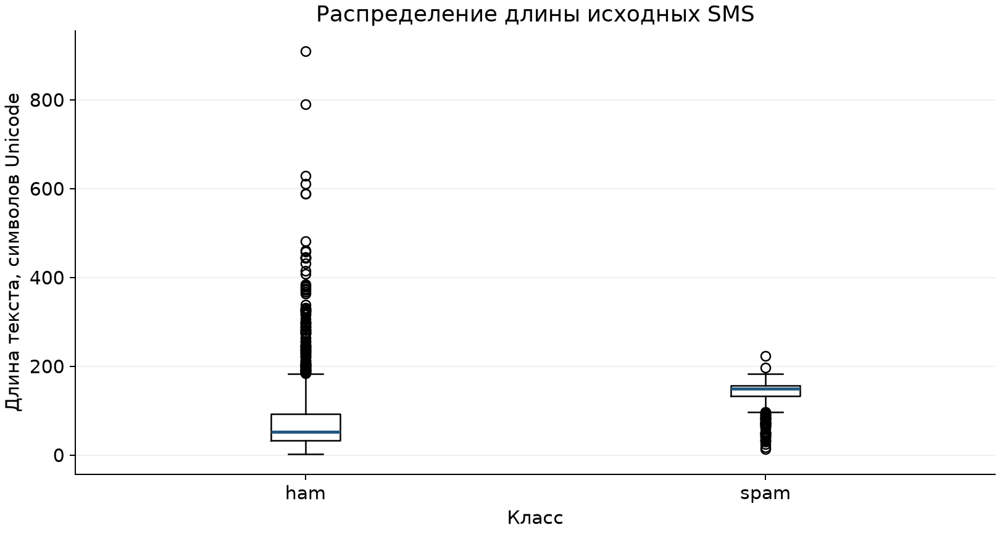

# Лабораторная работа № 1

**Тема:** подготовка защищённого окружения и выбор направления ML-проекта.

**Направление:** NLP, анализ текста.

**Дата подготовки:** 28 октября 2026 г.

## 1. Цель и границы выполненной работы

Подготовлены проект классификатора SMS, зафиксированный снимок открытого датасета,
анализ распределения, контроль целостности, зависимости и мини-модель угроз.
Подготовлены сценарии установки Ubuntu VM на Windows и сбора системных доказательств.

Выводы в этом документе относятся к контейнерной среде подготовки. Доступа к компьютеру
Windows и работающей учебной VM во время подготовки не было. Системные проверки VM
не подменяются результатами контейнера. Отдельный пользователь `mluser`, SSH, UFW,
обновления ОС, Docker и Compose на целевой VM пока не подтверждены.

## 2. Задача проекта

Будущая модель решает задачу бинарной классификации англоязычных SMS. Вход — текст
сообщения; выход — `ham` или `spam`. Пользователь — разработчик фильтра сообщений,
обращающийся к локальной функции или будущему API. В качестве исходной модели
предложены TF–IDF и логистическая регрессия. Обучение относится к следующим работам.

## 3. Версии и Python-окружение

В среде подготовки создан отдельный `.venv`. Полный список версий сохранён
в `requirements.txt`, перечень прямых зависимостей — в `requirements.in`.

| Компонент | Версия / статус в среде подготовки |
|---|---|
| ОС контейнера | Ubuntu 24.04.3 LTS |
| Python | 3.12.14 |
| Git | 2.51.1 |
| pip | 26.2.2 |
| pandas | 3.1.0 |
| Matplotlib | 3.11.2 |
| scikit-learn | 1.9.1 |
| JupyterLab | 4.6.4; библиотека установлена, сервер в контейнере не проверен |
| pip-audit | 2.10.1 |
| Docker, Docker Compose, UFW | На целевой VM требуют установки и проверки |

Подтверждение: `evidence/local/runtime.json`, `versions.log`, `pip-check.log`.
Результат `python -m pip check`:

```text
No broken requirements found.
```

Расчёты здесь выполнены с EUID 0 в контейнере. Это не подтверждает выполнение основной
разработки от обычного пользователя на учебной VM. На VM cloud-init создаёт `mluser`
без sudo и группы Docker, а `setup_project.sh` отказывается работать с EUID 0.
Подтверждением станут фактические `id`, `groups` и SSH-сессия `mluser` на VM.

## 4. Проверка зависимостей

Выполнена команда:

```bash
python -m pip_audit --format=json --output evidence/local/pip-audit.json
```

Результат от 28.10.2026:

| Показатель | Результат |
|---|---:|
| Пакетов в результате аудита | 123 |
| Пакетов с известными найденными уязвимостями | 0 |
| Пропущенных пакетов | 0 |
| Код завершения | 0 |

В `requirements.txt` 122 зафиксированные зависимости; сам pip по умолчанию не входит
в `pip freeze`, но входит в аудит установленных пакетов. Его версия отдельно зафиксирована
в инструкции установки. Результаты: `pip-audit.json`, `pip-audit.log`, `pip-audit.exitcode`,
`pip-audit-summary.txt` в `evidence/local/`.

Находок нет, поэтому таблица «библиотека — версия — идентификатор — исправление»
для этой проверки пуста. Результат не является гарантией отсутствия неизвестных
уязвимостей, вредоносных пакетов или ошибок собственного кода. На VM аудит повторяется
после установки; при ненулевом коде сценарий не объявляет Python-проверки завершёнными.

## 5. Git и структура

Структура содержит требуемые `data/`, `notebooks/`, `src/`, `models/`, `tests/`,
`requirements.txt`, `.gitignore` и `README.md`. Дополнительно выделены `security/`,
`scripts/`, `docs/`, `figures/`, `evidence/`.

Инициализирован локальный Git-репозиторий. Сырые данные, `.venv`, модели, `.env`,
приватные ключи и кэши исключены из Git. Эталонные хэши, агрегаты, Notebook и код
отслеживаются. Проверка правил и состава отслеживаемых файлов сохранена
в `evidence/local/git-checks.log`.

Удалённый репозиторий пока не создан; ссылка для сдачи появится после публикации.
Первоначальный технический коммит создан автоматически и не выдаётся за коммит студента.

Файл `.env` может содержать пароли и API-ключи. Публикация приводит к распространению
секретов через историю, клоны и резервные копии. `.gitignore` не удаляет уже попавшие
в коммиты секреты; необходимы ротация/отзыв и отдельная очистка истории.

## 6. Датасет

Название: **SMS Spam Collection**. Источник —
[UCI Machine Learning Repository](https://archive.ics.uci.edu/dataset/228/sms+spam+collection).
DOI: [10.24432/C5CC84](https://doi.org/10.24432/C5CC84).
Авторы: Tiago Almeida и José María Gómez Hidalgo, 2011.
Лицензия на странице UCI: CC BY 4.0.

Формат — текст UTF-8. Каждая строка содержит метку и SMS, разделённые первой табуляцией.
Один исходный признак — `text`; целевая переменная — `target`; классов два.

| Файл | Размер |
|---|---:|
| `data/raw/sms_spam_collection.zip` | 203 415 байт |
| `data/raw/SMSSpamCollection` | 477 907 байт |
| `data/raw/readme` | 5 868 байт |

Всего проверено 5 574 строки. Загрузчик не интерпретирует кавычки внутри SMS как
CSV-синтаксис и не отбрасывает записи. Путь загрузки и SHA256 сохранены в
`security/dataset-manifest.json`. Исходные файлы не преобразованы.

## 7. Распределение и качество данных

| Класс | Сообщений | Доля |
|---|---:|---:|
| ham | 4 827 | 86,5985% |
| spam | 747 | 13,4015% |
| Всего | 5 574 | 100% |


Датасет несбалансирован. Число обычных сообщений превышает число спам-сообщений
в 6,4618 раза, абсолютная разница — 4 080 сообщений. Искусственное выравнивание
не выполнялось. Прогноз `ham` для каждого объекта даёт accuracy 86,60% и нулевую
полноту класса `spam`; accuracy без метрик по классам недостаточна.

Для следующих работ предложены precision/recall/F1 для `spam`, macro-F1, balanced
accuracy и матрица ошибок. Перевзвешивание классов можно оценить экспериментально,
сохраняя исходное распределение в тесте.

Качество исходного снимка:

| Проверка | Результат |
|---|---:|
| Пропущенные ячейки | 0 |
| Пустые тексты | 0 |
| Избыточные дубликаты строк | 403 |
| Уникальные строки | 5 171 |
| Повторные нормализованные тексты сверх первого вхождения | 415 |
| Конфликтующие метки одинаковых исходных текстов | 0 |
| Конфликтующие метки одинаковых нормализованных текстов | 0 |

Нормализация для поиска групп: Unicode NFKC, casefold, свёртка пробельных символов.
Она не изменяет исходные данные. Дубликаты оставлены в снимке и должны учитываться
при групповом разделении на обучение и тест. Векторизатор должен обучаться только
на обучающей части.

| Класс | Медиана длины, символов Unicode | Средняя длина | Минимум | Максимум |
|---|---:|---:|---:|---:|
| ham | 52 | 71,47 | 2 | 910 |
| spam | 149 | 138,68 | 13 | 223 |



Длина не равна числу токенов или размеру файла. Выбросы не удалялись.
Возраст корпуса и английский язык ограничивают перенос выводов на современный
русскоязычный спам. Полной ручной проверки правильности меток не выполнялось.

## 8. Контроль целостности

Команда:

```bash
sha256sum data/raw/SMSSpamCollection
```

Фактический результат:

```text
7d039a24a6083ed9ef0f806ebad56bbb976e3aeb8de05669173bfdc4996c239d  data/raw/SMSSpamCollection
```

Архив:

```text
1587ea43e58e82b14ff1f5425c88e17f8496bfcdb67a583dbff9eefaf9963ce3  data/raw/sms_spam_collection.zip
```

Описание авторов:

```text
8753cd2d3cab68f80c8257851b8c2037778c267f55accb6fd1b5a2e32d36a84e  data/raw/readme
```

Все три значения проверены. Эталон сохранён в `security/SHA256SUMS` и
`security/dataset-manifest.json` отдельно от игнорируемых файлов данных.
Функция загрузки выполняет проверку до чтения датасета и завершает работу при изменении.

Негативный эксперимент меняет один байт временной копии с сохранением её размера.
Результат:

```text
PASS: изменение одного байта временной копии обнаружено.
PASS: оригинальный датасет и эталон сохранены без изменений.
```

Пять автоматических тестов прошли: исходный файл принимается; изменение байта,
отсутствие файла, путь с выходом через `..` и символьная ссылка за пределы проекта
отклоняются. Сама проверка не перезаписывает эталон.

На VM предусмотрен дополнительный системный эталон в `/var/lib/ml-lab/integrity/`
с правами `root:root 0444` и каталогом `root:root 0755`. Его установка и проверка прав
пока не выполнены на целевом стенде. `--require-protected-baseline` не позволяет
выдать обычную локальную копию за защищённую системную.

SHA256 показывает неизменность относительно сохранённого значения. Он не подтверждает
достоверность источника, правильность меток и отсутствие отравления до фиксации снимка.
Root способен заменить системный эталон. Для более сильной модели доверия требуются
подписи, защищённая история и независимая проверка происхождения.

## 9. Мини-модель угроз

Полная таблица из восьми угроз с четырьмя обязательными полями и отдельным статусом
контрмер приведена в [security/THREAT_MODEL.md](../security/THREAT_MODEL.md).
Она охватывает SSH, подмену файлов данных, отравление до фиксации, утечку секретов,
зависимости, дубликаты между выборками, Jupyter/Docker и обход будущего классификатора.

| Актив | Угроза | Возможное последствие | Контрмера и статус |
|---|---|---|---|
| SSH и ОС | Подбор пароля, удалённый вход root | Доступ нарушителя к VM | Ключи Ed25519, запрет root и паролей, UFW limit. Сценарии подготовлены; применение и новая сессия на VM пока не подтверждены. |
| Датасет | Подмена файлов после выбора снимка | Некорректный анализ и обучение | Реализованы SHA256 до загрузки, отдельный эталон в Git и негативный тест. Дополнительный эталон root вне проекта предложен и автоматизирован для VM. |
| Git | Утечка `.env`, ключей и токенов | Компрометация связанных сервисов | `.gitignore` реализован и проверен; текущий код не требует внешних API-секретов. Secret scanning и хранилище секретов предложены. |
| Python-зависимости | Известная уязвимость установленного пакета | Выполнение кода или недоступность | Реализованы venv, фиксированные версии, pip check и pip-audit: 123 пакета, известных находок нет. Повторный аудит на VM обязателен. |

Фактически реализованы проверка снимка данных, отказ при нарушении целостности,
негативный эксперимент, аудит зависимостей, правила Git и обнаружение повторов.
SSH, UFW, системный эталон root и работа от обычного пользователя на VM требуют
запуска и подтверждения. Групповое разбиение, семантическая проверка меток,
хранилище секретов и тесты обхода будущей модели предложены для дальнейших работ.

## 10. Системная защита: что необходимо подтвердить на VM

| Проверка | Подготовленная реализация | Требуемое доказательство |
|---|---|---|
| Linux и версии | Ubuntu 24.04, `install_system.sh` | `/etc/os-release`, Python, Git, Docker, Compose |
| Отдельный пользователь | `mluser`, без sudo и группы Docker | `id`, `groups`, выполнение Python-проверок с UID ≠ 0 |
| SSH | Ed25519, запрет root/паролей, проверка `sshd -t` и эффективного конфига | Новая сессия по ключу, отказ root, `sshd -T` |
| Firewall | UFW logging high, deny incoming, allow outgoing, limit на фактическом порту | `ufw status verbose`, `ufw status numbered`, новое соединение |
| Сетевая поверхность | `ss -tulpn`, `docker ps`, список служб | Конкретный процесс, адрес привязки, порт, необходимость каждого сервиса |
| Обновления | apt update, список до/после, apt upgrade | Журнал apt и оставшиеся обновления с объяснением |
| Python | venv обычного пользователя, фиксированные версии | `pip check`, observed requirements, аудит |
| Системный эталон | Отдельный root-каталог с запретом записи для mluser | `stat`, `sha256sum -c`, `check_integrity.py --require-protected-baseline` |

Слушающий порт не доказывает внешнюю доступность. Учитываются loopback / все интерфейсы,
UFW и сеть гипервизора. DNS stub на 127.0.0.53/127.0.0.54 может быть оставлен для
разрешения имён, DHCP — для адреса VM, SSH — для разработки. Jupyter должен слушать
127.0.0.1:8888, а доступ выполняется через туннель. Для любого другого процесса нужно
указать конкретное назначение либо отключить ненужную службу.

Docker в текущей работе не публикует контейнеры и сетевой API. Членство `mluser`
в группе Docker не требуется. При последующей публикации портов надо учитывать
отдельные правила Docker, которые могут обходить обычную фильтрацию UFW.

Таймер отката при настройке SSH/UFW не является независимой консолью гипервизора.
Для строгого выполнения требования об аварийной GUI-консоли приведён вариант VirtualBox
в `docs/START_WINDOWS.md`; `multipass shell/exec` используют гостевой SSH.

## 11. Статус исполнения Notebook и сценариев

Шесть кодовых ячеек Notebook последовательно выполнены внутри IPython, выходы сохранены.
Таблицы, статистика, графики и негативная проверка получены реальным выполнением кода.
Метод и ограничение записаны в `metadata.validation` Notebook и в журнале исполнения.

Стандартный Jupyter kernel не удалось запустить в контейнере: среда запрещает создание
TCP- и IPC-сокетов. Поэтому запуск отдельного Jupyter kernel/server не подтверждён.
На Ubuntu VM необходимо выполнить `nbconvert --execute`, как делает `setup_project.sh`.

Python-файлы проверяются компиляцией, Bash-сценарии — `bash -n`. Windows/VM-сценарии
не выполнялись на целевом оборудовании. Синтаксическая проверка не подтверждает
успешную установку пакетов, работу служб и сетевых правил. PowerShell-сценарии прошли
синтаксический разбор PowerShell 7.6.9; команды Windows при этом не исполнялись.
Оба графика визуально проверены как PNG. HTML-представление Notebook сформировано;
полная визуальная проверка его страницы не выполнена из-за недоступного браузерного движка.

## 12. Состав сдаваемых материалов

- Реальная ссылка на Git-репозиторий — добавить после его создания и публикации.
- `notebooks/01_dataset_analysis.ipynb`.
- `requirements.txt`, `requirements.in`, `.gitignore`.
- `README.md` с воспроизведением проекта.
- Этот отчёт и `security/THREAT_MODEL.md`.
- `security/SHA256SUMS`, `security/dataset-manifest.json`.
- После настройки стенда: `docs/VM_REPORT.md` и выбранные выводы команд без секретов.

Полная готовность к сдаче требует завершить системные проверки на реальной VM,
просмотреть сетевую поверхность, подтвердить запуск Jupyter и предоставить ссылку
на удалённый репозиторий. Максимальная оценка до этих проверок не заявляется.

## Источники

1. [UCI SMS Spam Collection](https://archive.ics.uci.edu/dataset/228/sms+spam+collection).
2. [NIST AI 100-2 E2025](https://csrc.nist.gov/pubs/ai/100/2/e2025/final), March 2025.
3. [Ubuntu Server: OpenSSH](https://ubuntu.com/server/docs/how-to/security/openssh-server/).
4. [Ubuntu Server: Firewall](https://ubuntu.com/server/docs/firewalls/).
5. [Docker: Packet filtering and firewalls](https://docs.docker.com/engine/network/packet-filtering-firewalls/).
6. [Canonical Multipass: installation](https://canonical.com/multipass/docs/latest/how-to-guides/install-multipass/).
7. [VS Code: Remote SSH](https://code.visualstudio.com/docs/remote/ssh).
