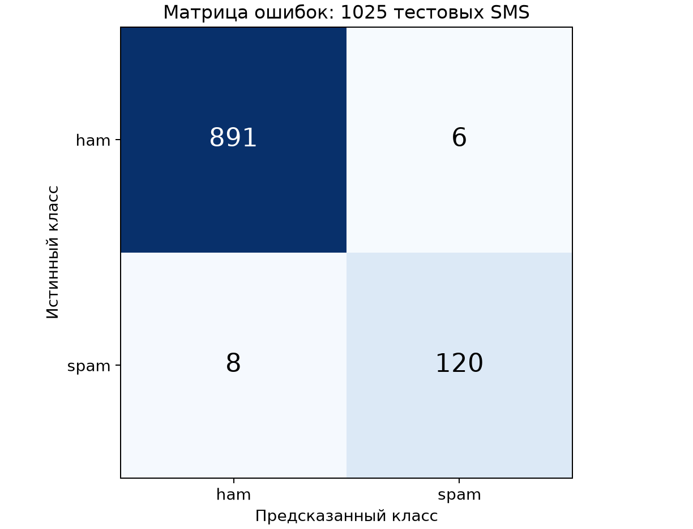
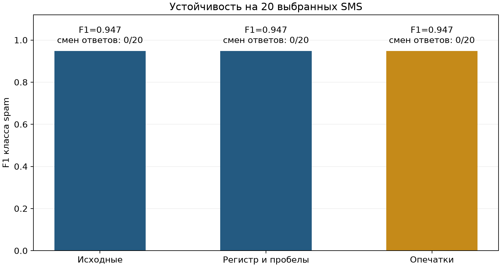

# Лабораторная работа №2. Базовая NLP-модель и устойчивость входов

Сформировано: 2026-11-01T12:23:24.445996+00:00. Среда: **Целевая Ubuntu VM, пользователь mluser**.

Репозиторий: https://github.com/VaisouI/NLP. Модель — TF-IDF + LogisticRegression для англоязычных SMS; классы ham и spam. Вход — объект с единственным строковым полем text, выход — prediction и model_version.

## Данные, решения и достаточность

Источник: UCI SMS Spam Collection, https://archive.ics.uci.edu/dataset/228/sms+spam+collection, DOI 10.24432/C5CC84. Один текстовый признак и две метки. Исходный файл не изменён.

SHA256: `7d039a24a6083ed9ef0f806ebad56bbb976e3aeb8de05669173bfdc4996c239d`. Исходных объектов: 5574; ham: 4827, spam: 747. Пропусков и пустых текстов: 0 и 0.

Исключено недопустимых входов: 35 ({'control_character': 35}); удалено повторов нормализованного текста сверх первого: 415. Осталось 5124: {'ham': 4484, 'spam': 640}. Метки не изменялись, пропуски не заполнялись, ресэмплинг классов не выполнялся.

Управляющие символы U+0091…U+0096 встречаются в старом корпусе; такие строки отклоняются той же политикой, что вход предсказания. NFKC, casefold и объединение пробелов используются для сравнения текстов; первое вхождение каждой группы сохраняется.

Объёма и представленности обоих классов достаточно для учебной линейной модели и отдельных оценок, но корпус старый, англоязычный и несбалансированный. Нет идентификаторов пользователей и времени: гарантируется отсутствие одинаковых нормализованных текстов между выборками, но не всех возможных связей источника. Представленность современного и русскоязычного спама не установлена.

## Разделение и обучение

Seed = 42. Стратифицированные train/CI/test около 60/20/20; SHA256 схемы разделения: `501059ed268a2ddd6019bd422ced9d6031374891c633944e791e0042f464834b`. Пересечений нормализованных текстов: 0.

| Выборка | Всего | ham | spam |
|---|---:|---:|---:|
| train | 3074 | 2690 | 384 |
| ci | 1025 | 897 | 128 |
| test | 1025 | 897 | 128 |

Словарь TF-IDF и IDF обучены только на train. Предобработка одинакова при fit, оценке и предсказании. class_weight=balanced учитывает дисбаланс в функции потерь. Параметры заданы заранее; по тесту ничего не настраивалось.

```json

{
  "model_version": "lab2-v1",
  "seed": 42,
  "deduplicate_normalized_text": true,
  "test_fraction": 0.2,
  "ci_fraction": 0.2,
  "main_metric": "f1_spam",
  "normalization_version": "nfkc-casefold-whitespace-v1",
  "input_policy": {
    "max_characters": 4096,
    "max_utf8_bytes": 16384,
    "missing_values": "reject",
    "extra_fields": "reject"
  },
  "tfidf": {
    "ngram_range": [
      1,
      2
    ],
    "min_df": 2,
    "max_features": 20000,
    "sublinear_tf": true
  },
  "logistic_regression": {
    "C": 1.0,
    "class_weight": "balanced",
    "solver": "liblinear",
    "max_iter": 1000
  },
  "robustness": {
    "samples_per_class": 10,
    "max_typo_tokens": 3
  }
}

```

Время обучения: 0.276909 с; признаков в словаре: 7520; scikit-learn: 1.9.1. Сохранены параметры, время, версия, fingerprint кода и исходный commit: `169e1f1ff6add6742a85f34aa3cc3e31bcdaf197`.

## Качество

Основная метрика — binary F1 для spam, zero_division=0. Precision, recall и F1 показаны по классам; macro-F1 усредняет классы поровну.

| Модель / выборка | Accuracy | F1 spam | Macro-F1 | Balanced accuracy |
|---|---:|---:|---:|---:|
| TF-IDF + LR, test | 0.986341 | 0.944882 | 0.968543 | 0.965406 |
| Всегда ham, test | 0.875122 | 0.000000 | 0.466701 | 0.500000 |
| TF-IDF + LR, CI | 0.985366 | 0.941176 | 0.966410 | 0.964848 |
| Класс | Precision | Recall | F1 | Support |
|---|---:|---:|---:|---:|
| ham | 0.991101 | 0.993311 | 0.992205 | 897 |
| spam | 0.952381 | 0.937500 | 0.944882 | 128 |



Порядок строк и столбцов: ham, spam. Матрица: `[[891, 6], [8, 120]]`. Отложенный тест: 1025 SMS. `metrics/baseline.json` — независимый тест, `metrics/baseline_ci.json` — отдельный неизменяемый контроль для повторных проверок ЛР3. Они автоматически не перезаписываются.

### Примеры ошибочных решений

Всего ошибок: 14. Тексты не публикуются; номер строки позволяет сверить пример в приватной копии исходного корпуса. Длина и покрытие словаря описывают ошибку, но не доказывают её причину.

| Строка источника (с 0) | Истинный класс | Предсказание | Символов | Ненулевых признаков | Score spam |
|---|---|---|---:|---:|---:|
| 84 | ham | spam | 14 | 3 | 0.2277 |
| 153 | ham | spam | 25 | 3 | 0.4864 |
| 180 | ham | spam | 126 | 26 | 0.1662 |
| 1056 | ham | spam | 24 | 6 | 0.0222 |
| 1458 | spam | ham | 153 | 15 | -0.2842 |
| 1500 | spam | ham | 154 | 22 | -0.0036 |
| 1674 | spam | ham | 73 | 12 | -0.3671 |
| 2248 | spam | ham | 159 | 20 | -0.1099 |

Ham → spam — ложное срабатывание, spam → ham — пропуск спама. Лексическая модель не моделирует намерение автора; короткие сообщения и необычные формулировки требуют отдельного анализа. Дальнейшие изменения следует проверять на CI/валидации, не подбирая параметры по финальному тесту.

В data/processed/lab2/error-analysis-private.json приватного архива приведены исходные тексты этих примеров и пять наибольших по абсолютному значению вкладов TF-IDF × коэффициент LR. Положительный вклад увеличивает score spam, отрицательный уменьшает. Это разбор вычисленного решения, а не доказательство реального намерения автора.

## Позитивные и негативные проверки

Рабочие пределы: 4096 кодовых точек и 16384 байта UTF-8 до и после NFKC/casefold/пробельной нормализации. Это больше максимальной длины корпуса и ограничивает обработку одного SMS. Null, NaN/Inf, неверный тип, лишние поля, управляющие символы и невалидный Unicode отклоняются. В демонстрации пределы уменьшены до 64/96; больших файлов не создавалось.

| Случай | Ожидается | Фактически | Вызовов модели | Результат |
|---|---|---|---:|---|
| valid synthetic SMS | valid prediction | {"prediction": "ham", "model_version": "lab2-v1"} | 1 | PASS |
| not an object | invalid_structure | "invalid_structure" | 0 | PASS |
| missing text | invalid_fields | "invalid_fields" | 0 | PASS |
| extra field | invalid_fields | "invalid_fields" | 0 | PASS |
| wrong text type | invalid_type | "invalid_type" | 0 | PASS |
| null | invalid_type | "invalid_type" | 0 | PASS |
| NaN | invalid_type | "invalid_type" | 0 | PASS |
| Inf | invalid_type | "invalid_type" | 0 | PASS |
| empty | empty_text | "empty_text" | 0 | PASS |
| character limit 65 > 64 | text_too_long | "text_too_long" | 0 | PASS |
| UTF-8 byte limit 98 > 96 | text_too_large | "text_too_large" | 0 | PASS |
| normalization expansion | normalized_too_large | "normalized_too_large" | 0 | PASS |
| control character | control_character | "control_character" | 0 | PASS |
| invalid Unicode surrogate | invalid_unicode | "invalid_unicode" | 0 | PASS |

Pytest: 42 тестов, ошибок/падений: 0. Проверяются форма ответа, известный расчёт метрик, отсутствие утечки, неизменность baseline, контроль загрузки и валидация до обращения к модели. Полный JUnit XML и вывод — в приватном архиве.

CLI читает максимум 65536 байт JSON. Проверка уже созданного Python-объекта не предотвращает расход памяти до вызова функции; потоковый HTTP body limit относится к ЛР4.

## Эксперимент с изменёнными входами

Фиксированный seed, 20 сообщений из теста: 10 ham и 10 spam. Опечатки — перестановка двух букв максимум в трёх словах. Предполагается сохранение смысла и метки. Исходный файл не изменялся; приватная копия преобразований включена в архив. Параметры модели после эксперимента не подбирались.

| Вариант | Изменилось ответов | Доля изменений | F1 spam | Среднее абсолютное изменение decision score |
|---|---:|---:|---:|---:|
| Исходные | 0 | 0 | 0.947368 | 0 |
| case_and_whitespace | 0 | 0.0000 | 0.947368 | 0.000000 |
| typos | 0 | 0.0000 | 0.947368 | 0.223829 |



Регистр и пробелы нормализуются. Нулевая доля смены класса на этой малой выборке не доказывает устойчивость; изменение decision_function отражает чувствительность численного решения, а не калиброванную вероятность.

Нетипичный вход: синтетическая строка только из эмодзи, 60 кодовых точек. Вход допустим по схеме; результат `ham`, ненулевых TF-IDF-признаков 0. Формальный OOD-детектор не реализован. Проверка формы не устанавливает принадлежность обучающему распределению.

Предложено отдельно оценить покрытие словаря и механизм отказа на валидационной выборке, расширить эксперимент типичными опечатками и современными SMS. Этот эксперимент не является доказательством устойчивости ко всем adversarial-атакам.

## Защита данных, модели и Jupyter

Модель `models/lab2-v1/model.skops`, 1566910 байт, формат skops. SHA256: `01c009c7f3d92ee711a25c987ab39649a14bd3c3565685e66ac7aefdcd0b4940`. До десериализации проверяются размер, SHA256, версия scikit-learn и отсутствие неизвестных типов. Автоматического доверия к содержимому артефакта нет; загружается только собственная модель.

Обученный TF-IDF и классификатор сохранены вместе. Нормализация — версионированная функция в src/preprocessing.py, её правила и конфигурация фиксируются вместе с моделью. Хэш не доказывает корректность обучения; root остаётся доверенной границей.

Модель, исходные SMS, индексы разбиения, приватные примеры и журналы исключены из публичного Git. Для преподавателя они передаются в lab2-results.zip через закрытую учебную платформу. В Git находятся код, обезличенные результаты, хэши и Notebook.

### Фактическая проверка среды

```json

{
  "user": "mluser",
  "uid": 1001,
  "protected_model_reference": "/var/lib/ml-lab/model-integrity/lab2-v1.json",
  "reference_owned_by_root_read_only": true,
  "model_load_and_prediction_ok": true,
  "model_tamper_detected": true,
  "jupyter_host": "127.0.0.1",
  "jupyter_port": 8888,
  "jupyter_authentication_enabled": true,
  "unauthenticated_api_status": 403,
  "token_in_report": false
}

```

```json

{
  "ssh_local_forward": "127.0.0.1:18888 -> VM 127.0.0.1:8888",
  "unauthenticated_api_status": 403,
  "token_in_report": false
}

```

```text

mluser mluser 750 /home/mluser
mluser mluser 750 /home/mluser/ml-project
mluser mluser 700 /home/mluser/ml-project/data/raw
mluser mluser 700 /home/mluser/ml-project/models
mluser mluser 400 /home/mluser/ml-project/models/lab2-v1/model.skops
root root 444 /var/lib/ml-lab/model-integrity/lab2-v1.json

```

```text

Netid State  Recv-Q Send-Q  Local Address:Port  Peer Address:PortProcess                                               
udp   UNCONN 0      0          127.0.0.54:53         0.0.0.0:*    users:(("systemd-resolve",pid=546,fd=16))            
udp   UNCONN 0      0       127.0.0.53%lo:53         0.0.0.0:*    users:(("systemd-resolve",pid=546,fd=14))            
udp   UNCONN 0      0      10.0.2.15%ens3:68         0.0.0.0:*    users:(("systemd-network",pid=683,fd=21))            
tcp   LISTEN 0      128         127.0.0.1:8888       0.0.0.0:*    users:(("jupyter-lab",pid=1701,fd=6))                
tcp   LISTEN 0      4096    127.0.0.53%lo:53         0.0.0.0:*    users:(("systemd-resolve",pid=546,fd=15))            
tcp   LISTEN 0      4096          0.0.0.0:22         0.0.0.0:*    users:(("sshd",pid=824,fd=3),("systemd",pid=1,fd=94))
tcp   LISTEN 0      4096       127.0.0.54:53         0.0.0.0:*    users:(("systemd-resolve",pid=546,fd=17))            
tcp   LISTEN 0      4096        127.0.0.1:46557      0.0.0.0:*    users:(("containerd",pid=805,fd=13))                 
tcp   LISTEN 0      4096             [::]:22            [::]:*    users:(("sshd",pid=824,fd=4),("systemd",pid=1,fd=95))

```

Jupyter работает от mluser на loopback с включённой аутентификацией. Вывод содержит только факт настройки, HTTP-код отказа без токена и проверку SSH-туннеля. Значение токена и приватный SSH-ключ в отчёт не включаются.

## Bandit, зависимости и версии

Bandit: находок 0, ошибок сканирования 0. Исключения и nosec не используются. Применимых находок для исправления нет при успешном отчёте.

pip-audit: пакетов 130, уязвимостей 0, пропусков 0. Проверка относится к известным уязвимостям на дату запуска; фиксация версий не заменяет аудит.

```json

{
  "user": "mluser",
  "uid": 1001,
  "python": "3.12.3",
  "packages": {
    "scikit-learn": "1.9.1",
    "skops": "0.16.0",
    "pandas": "3.1.0",
    "numpy": "2.5.4",
    "pytest": "9.2.0",
    "bandit": "1.9.4",
    "jupyterlab": "4.6.4",
    "pip-audit": "2.10.1",
    "pip": "26.2.2"
  },
  "started_at_utc": "2026-11-01T12:22:19.464860+00:00",
  "source_commit": "169e1f1ff6add6742a85f34aa3cc3e31bcdaf197"
}

```

## Итог проверок

| Проверка | Результат |
|---|---|
| Датасет соответствует SHA256 ЛР1 | PASS |
| Тексты между train, CI и test не пересекаются | PASS |
| Модель сохранена и SHA256 совпадает | PASS |
| Основная метрика и отдельный контроль CI сохранены | PASS |
| Позитивная и минимум четыре негативные проверки прошли | PASS |
| Pytest прошёл без ошибок | PASS |
| Bandit не содержит находок или ошибок сканирования | PASS |
| pip-audit завершён без находок и пропусков | PASS |
| Окружение соответствует requirements.txt | PASS |
| Эксперимент выполнен на 20 тестовых SMS | PASS |
| Notebook содержит выполненные ячейки без ошибок | PASS |
| ML-работа выполнена от mluser | PASS |
| Notebook выполнен Jupyter на целевой VM | PASS |
| Внешний эталон модели принадлежит root и закрыт для записи | PASS |
| Сохранённая модель загружается; изменение копии обнаружено | PASS |
| Jupyter привязан к loopback и требует аутентификацию | PASS |
| Доступ через SSH-туннель проверен | PASS |
| Каталоги данных и модели закрыты для остальных | PASS |

## Команды воспроизведения

```bash

python -m src.cli train

python -m src.cli evaluate

python -m src.cli robustness

python -m src.cli validate

python -m pytest tests/ -q

python -m bandit -r src/

printf '%s' '{"text":"Project lab2 meeting tomorrow at noon"}' | python -m src.cli predict

sha256sum models/lab2-v1/model.skops

```

После клонирования восстановите models/ из приватного архива преподавателя. Автоматическая замена установленного baseline другим обучением запрещена. Подготовку и сбор фактических доказательств выполняет scripts/codespaces/run_lab2.sh в сохранённом Codespace ЛР1.

Материалы ЛР1 сохранены в docs/VM_REPORT.md и notebooks/01_dataset_analysis.ipynb. Для ЛР2 сдаётся этот отчёт, notebooks/02_baseline_robustness.ipynb, metrics/, код и приватный архив с артефактом.
