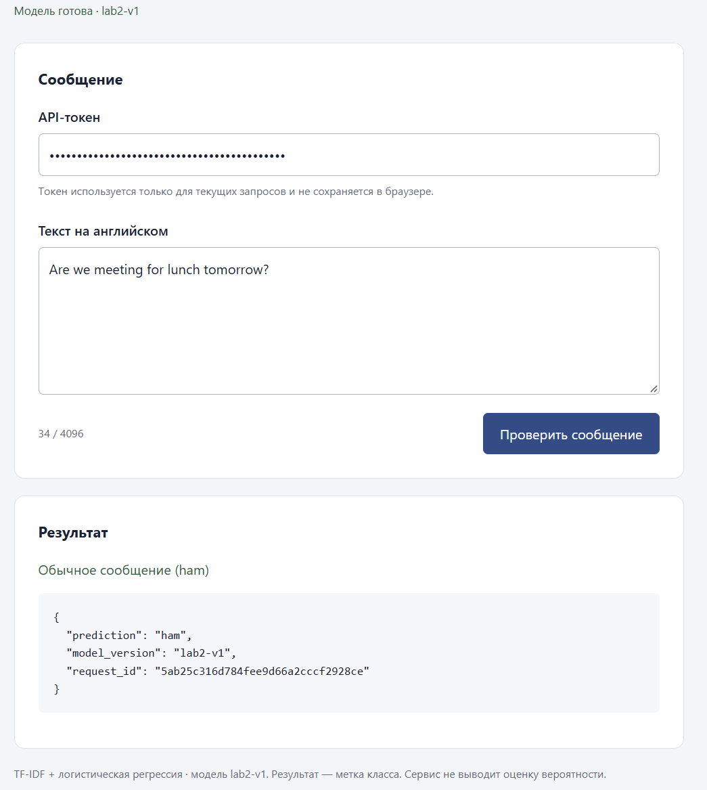
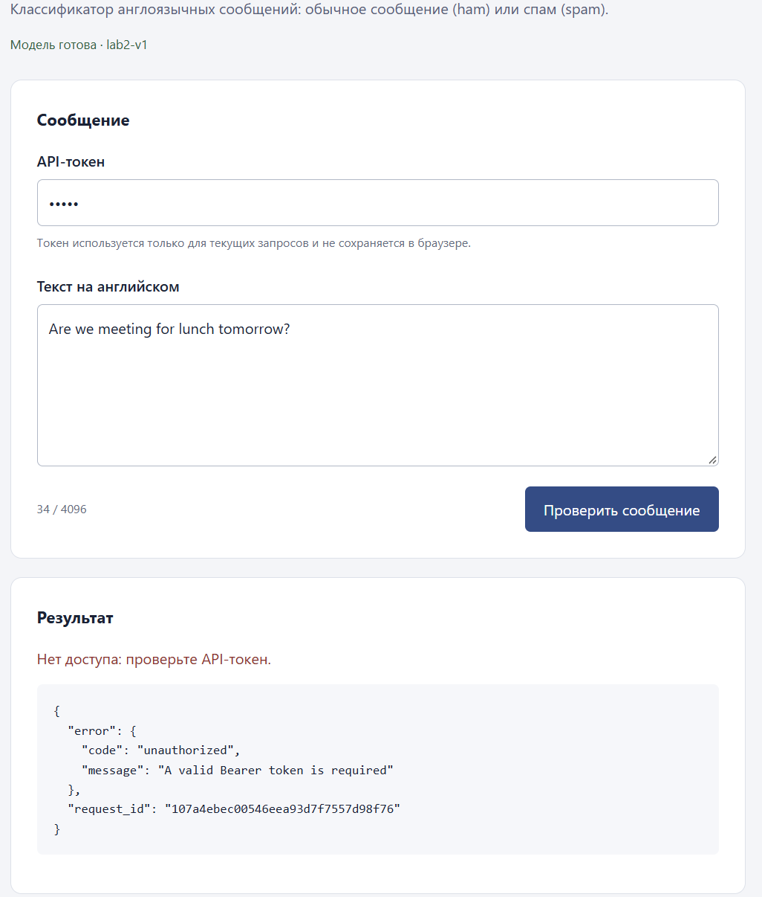
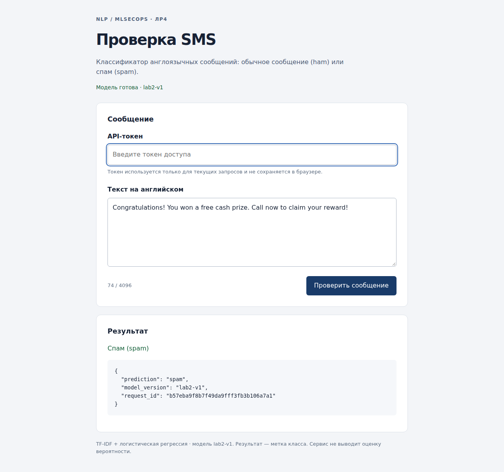
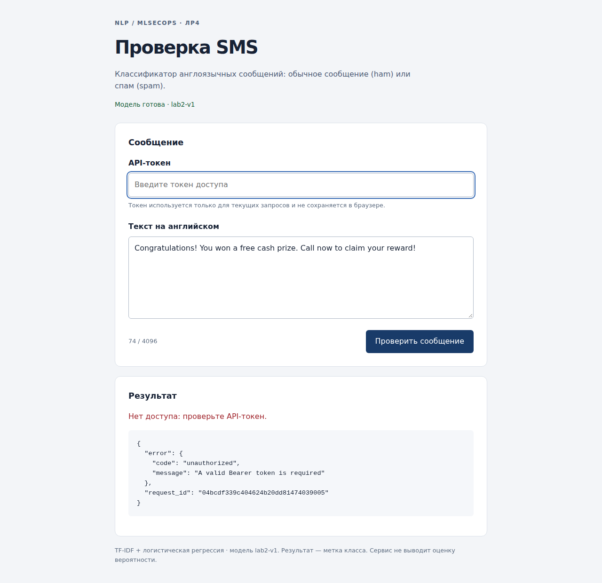

# ЛР4. Фактические результаты выполнения

Обновлено: **02.11.2026**. Ниже приведены подтверждённый запуск на целевой Ubuntu VM
и успешный CI [41422213613](https://github.com/VaisouI/NLP/actions/runs/41422213613)
для снимка `1ead3569958b21c9fd3d6af0d840c787bd54d149`.
Первоначальный CI от 1 ноября сохранён отдельным историческим разделом.
Текущий статус main доступен на
[странице CI](https://github.com/VaisouI/NLP/actions/workflows/ci.yml).

## 0. Подтверждение целевой VM от 2 ноября

На сохранённой Ubuntu VM выполнены проверки и запущен `ml-lab4-api.service`.
Фактический пользователь **mluser, UID 1001**; bind **127.0.0.1:8000**,
`/health` = **200**, внешний защищённый эталон модели не доступен для записи.
Используется исходная модель ЛР2 с SHA256:

```text
01c009c7f3d92ee711a25c987ab39649a14bd3c3565685e66ac7aefdcd0b4940
```

На VM пройдены **135 тестов** (17,90 с, 0 ошибок/падений/пропусков), Ruff и Bandit.
Аудит **144 пакетов** дал 0 известных находок и 0 пропусков. Одно предупреждение
Starlette/TestClient не является падением; отдельно прошли реальные HTTP-проверки.

Подтверждены все 14 случаев из `http-cases.json`. Изменённая копия модели дала
`/health 503` и `/predict 503`; оригинал и эталон сохранены. Серия трёх неверных
токенов 02.11.2026 в **11:51:44,275730–11:51:44,279116 МСК** дала три HTTP 401,
увеличение счётчика /predict 401 с **2 до 5** и **0 дополнительных обращений к модели**.
В журнале за этот интервал найдены три события; `triggered=true`. После сценария
predict и health вернули 200; отдельно проверены 429 и восстановление после окна.





[Архив целевой VM](../evidence/lab4/vm-results-20261102.zip): 23 файла, 25 934 байта.
SHA256 `ac08eeb15752822273afafad81541377ea9f135765a89cdfe617ab63daaddf43`.
[Сводка VM](../evidence/lab4/vm-summary.json). Токены, SSH-ключи, диски, модель и SMS
в архив не включены. Веб-снимки содержат только замаскированное поле токена.

Финальный CI для кода `1ead3569958b21c9fd3d6af0d840c787bd54d149`:
[run 41422213613](https://github.com/VaisouI/NLP/actions/runs/41422213613), **success**,
135 тестов, UID контейнера 10001, loopback-публикация, API и detection в Docker.
[Его полный архив](../evidence/lab4/ci-41422213613.zip), SHA256
`5760b68e472801fb10c967356917096b4345de52a499d2860dab2b9df888d373`.
В сканировании **02.11.2026** уже **191 запись**: LOW 62 / MEDIUM 76 / HIGH 45 /
UNKNOWN 8 / CRITICAL 0. Восемь UNKNOWN разрешены по первичным CVSS из снимка
`fc3a53ca1eb4fc15827d753584917bc14e9dab5f`: LOW 63 / MEDIUM 80 / HIGH 48 /
UNKNOWN 0 / CRITICAL 0. Исходные JSON сохранены; HIGH и ниже остаются риском.
SHA кандидата именно этого CI —
`a8e1a3327a383322022db865c208790873b3660ee44f237738aadb27939eff44`;
он относится к отдельной сериализации и не подменяет SHA исходной модели VM.

Обнаруженный таймер общего SSH-туннеля исправлен отдельным persistent master.
[Тест 41421720322](https://github.com/VaisouI/NLP/actions/runs/41421720322)
воспроизвёл исчезновение прежнего туннеля после простоя и подтвердил сохранение
исправленного. Для восстановления доступа предусмотрен `lab4-fix-access.py`,
порт 18001, Private и внутренний HTTP при внешнем HTTPS GitHub.

## Сохранённый первоначальный CI от 1 ноября

Ниже сохранены результаты первого запуска 41344003120. Числа 183 и SHA bc04…
относятся только к нему; актуальный серверный запуск и новый CI описаны выше.

## 1. Среда и сохранённая модель

GitHub-hosted runner Ubuntu 24.04; Python 3.12.16; FastAPI 0.162.0,
Uvicorn 0.54.0, scikit-learn 1.9.1, skops 0.16.0, prometheus-client 0.26.0.
Образ — официальный python:3.12.16-slim-trixie; scanner Trivy 0.76.1.
В runtime-образе 26 необходимых зависимостей; в проверенном полном окружении 144.

Модель `lab2-v1`: TF-IDF + LogisticRegression, нормализация NFKC/casefold/пробелы.
Кандидат CI повторяет алгоритм и split ЛР2; исходный приватный артефакт ЛР2 не
перезаписывается. CI F1 spam = **0,9411764705882353**, baseline такое же,
порог с допустимым относительным снижением 5% — **0,8941176470588235**.
Финальный test не оценивается повторно и не используется для подбора модели.

SHA256 модели именно данного запуска:

```text
bc04b5206712a422ba794104bbbec65231f46087c6a7e797fa1103ec139b0591
```

Размер модели: **1568689 байт**. Отдельный манифест проверяется до загрузки.
После запуска процесса модель повторно не загружается для каждого запроса.

## 2. Проверки кода и зависимостей

| Проверка | Подтверждённый результат |
|---|---|
| pytest | **135 passed**, 0 ошибок/падений; 12,64 с |
| Ruff | Успех, JSON-отчёт без нарушений |
| Bandit | Успех, находок и ошибок сканирования нет; два точечных обоснованных исключения |
| pip-audit | **144 пакета, 0 известных уязвимостей, 0 пропусков** |
| Data gate | Фиксированный CI-контроль 1025 SMS, схема/распределение/SHA соответствуют правилам |
| Model gate | Кандидат проходит порог; baseline не перезаписан |

Есть одно предупреждение Starlette о будущем прекращении поддержки httpx в
TestClient. Оно не является падением теста; установленный зафиксированный стек
прошёл реальные HTTP-проверки и браузерную проверку независимо от TestClient.
Исключения Bandit B104/B310 объяснены в
[security/BANDIT_EXCEPTIONS.md](../security/BANDIT_EXCEPTIONS.md); глобальных skips нет.

## 3. Положительные и негативные HTTP-проверки

| Случай | Ожидаемый HTTP | Полученный HTTP |
|---|---:|---:|
| Готовность модели | 200 | 200 |
| Загрузка страницы | 200 | 200 |
| Корректное предсказание | 200 | 200 |
| Нет токена | 401 | 401 |
| Неверный токен | 401 | 401 |
| Пустой текст | 422 | 422 |
| Число вместо строки | 422 | 422 |
| Превышение длины после JSON-декодирования | 413 | 413 |
| Неподдерживаемый Content-Type | 415 | 415 |
| Повреждённый JSON | 400 | 400 |
| Сверхлимитный chunked body без Content-Length | 413 | 413 |
| Метрики без отдельного токена | 401 | 401 |
| Корректный запрос после сценария | 200 | 200 |
| Готовность после сценария | 200 | 200 |

Все отклонённые входы в этом наборе дали **0 дополнительных dispatch в модель**:
это подтверждено сравнением `ml_api_inference_total` до и после негативных входов.
135 автоматических тестов дополнительно проверяют дубликаты JSON-полей, NaN/Inf,
управляющие символы, неверный SHA/версию, ложный Content-Length, медленное тело,
параллелизм, безопасные логи/labels и серверную остановку зависшего процесса.

На изменённой копии модели настоящий второй HTTP-сервер вернул **/health 503**
со статусом unavailable и **/predict 503**. Оригинальная модель и эталон не менялись.
Пути файлов и traceback в ответ не попали. Полный результат: `lab4/local/integrity-probe.json`.

## 4. Ресурсы, аутентификация и интерфейс

Применены: потоковое тело до 32768 байт, 4096 символов/16384 UTF-8 байта до и после
нормализации, 3 с на чтение тела, 16 HTTP-запросов, один inference-slot без очереди.
Серверный deadline предсказания 2 с включает pipe I/O. Зависший процесс завершается
и reap; новый worker повторно проверяет хэш модели, до готовности health не 200.
Тест с ограниченным sleeping child подтвердил завершение старого PID и восстановление.

Для predict и metrics используются разные временные случайные Bearer-токены,
передаваемые только через окружение. Реальных секретов CI не требует. Токены не
попали в отчёты, URL, слои образа и снимки. Рабочий rate limit — 10/60 с; в отдельном
демо-процессе окно уменьшено до 2 с. Одиннадцать запросов дали ровно десять 200 и
один 429; после ожидания окна корректное предсказание снова вернуло 200.

Страница проверена в настоящем Chromium **156.0.8078.4**. Подтверждены успешный
predict и обработанный 401. Перед каждым снимком поле токена очищено.





Ответы выводятся как текст. В HTML/JS нет встроенного токена или localStorage;
страница работает на том же origin, CORS со звёздочкой не используется.

## 5. Сценарий обнаружения и восстановление

Правило из `config/detection.json`: **не менее 3 HTTP 401 на /predict за интервал
до 60 с**. Это проверка по JSON-журналам конкретного интервала, без заявления об
отдельном постоянно работающем alert-сервисе.

Локальный API: **01.11.2026 22:55:40,934421–22:55:40,937240 МСК**
(19:55:40 UTC). Три контролируемых запроса дали `[401, 401, 401]`, счётчик
`ml_api_requests_total{route="/predict",status="401"}` вырос на **3**.
В тех же границах найдено 3 записи, `triggered=true`.
Нормальный запрос до и после сценария — **200**, готовность после — **200**.

Логи содержат время, request_id, нормализованный route, HTTP-код, длительность,
версию модели и тип отказа. Текст SMS, токены, IP и произвольные query/path не
записываются. Метрики не используют request_id и входные данные как labels.
Защищённый /metrics проверен отдельным credential. Метрики до/после и результат
правила сохранены для API и контейнера независимо.

Приложение не видит отказы GitHub, SSH, TLS и HTTP-протокола до ASGI. Их следует
наблюдать отдельно. Этот сценарий показывает обнаружение отказов аутентификации,
а не доказывает атаку на веса/данные модели или снижение F1.

## 6. Контейнер, сканирование и CI

Фактический UID: **10001**. Контейнер запущен с read-only FS, cap-drop ALL,
no-new-privileges, 512 MiB, 1 CPU, 64 PID и отдельным ограниченным /tmp.
Проверено: **HostIp=127.0.0.1**, container port=8000; эталон модели **не доступен
для записи**. Docker socket и privileged не используются.
Smoke и все HTTP/метрики/detection внутри работающего контейнера прошли успешно.

Trivy config: ошибок конфигурации нет. Trivy image: **183 записи**, изначально
LOW 62 / MEDIUM 67 / HIGH 46 / UNKNOWN 8 / CRITICAL 0.
Восемь UNKNOWN получили первичные оценки CNA/CISA из закреплённого снимка CVE
Program `ef589f6fd938802940dd12b08004f9ce06023b60`; все исходные JSON и SHA сохранены.
После уточнения LOW 63 / MEDIUM 71 / HIGH 49 / UNKNOWN 0 / CRITICAL 0.
Ни одна исходная находка не удалялась. Security gate соответствует заявленной
минимальной политике, но **не означает отсутствия уязвимостей**: HIGH и ниже
остаются риском и требуют дальнейшего устранения.

Сохранены data/model/security gates ЛР3, 5%-порог baseline, статический анализ и
аудит. Последующие обязательные этапы зависят от успеха предыдущих. Диагностика
сохраняется при успехе и отказе. У CI contents:read, timeout 25 мин, actions
закреплены полными SHA; runtime-токены не передаются из GitHub Secrets.

## 7. Материалы и границы подтверждения

* Код, схема и команды: [LAB4.md](LAB4.md), `src/api*`, `src/inference*`, `static/`, `tests/`.
* Полный исходный artifact: [evidence/lab4/lab4-results.zip](../evidence/lab4/lab4-results.zip).
* Сводка: [evidence/lab4/summary.json](../evidence/lab4/summary.json).
* В ZIP находятся все 55 реальных файлов проверок ЛР3–ЛР4: тесты, аудит, Trivy,
  CVE-источники, манифест/метрики/SHA модели, логи, метрики до/после, detection,
  integrity probe, container runtime и снимки страницы. Модель и SMS в ZIP не входят.

SHA256 исходного ZIP:

```text
39a60c654d2760c9cb82c67ae69abbe860157f81f6e65c5a88e0f853e65b2a10
```

Первоначальный CI от 1 ноября предшествовал развёртыванию интерактивной VM.
Серверные результаты от 2 ноября, исходный архив VM, оба ручных веб-снимка и
исправление туннеля приведены в разделе 0 выше. Постоянный сервис на VM запущен
непосредственно из Python-окружения от mluser; Docker API отдельно проверен в CI.
