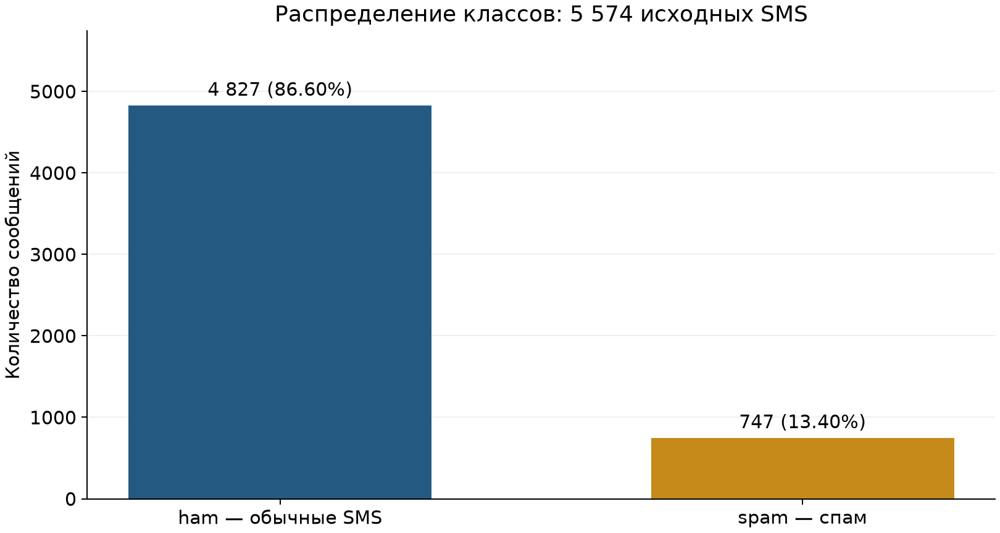

# Результаты проверки целевой виртуальной машины

Отчёт сформирован: 2026-10-28T15:18:56.188363+00:00 (UTC).

## Проект и данные

Направление — NLP. Задача будущей модели — классификация англоязычных SMS на ham и spam. Вход — текст сообщения, выход — метка класса; пользователь — разработчик фильтра сообщений. Обучение модели относится к следующим работам.

Источник: [SMS Spam Collection](https://archive.ics.uci.edu/dataset/228/sms+spam+collection); DOI 10.24432/C5CC84; лицензия по UCI — CC BY 4.0. Один текстовый признак, одна целевая метка, два класса.

| Класс | Количество | Доля, % |
|---|---:|---:|
| ham | 4827 | 86.5985 |
| spam | 747 | 13.4015 |

Всего 5574 сообщений. Отношение численности классов 6.4618:1. Избыточных точных повторных строк: 403; пропущенных значений: 0. Исходный файл не балансировался и не очищался. При дальнейшем разбиении одинаковые нормализованные тексты должны попадать в одну группу. Accuracy константного прогноза ham составляет 86,60%; для обучения нужны метрики по классам.



Анализ выполнен в notebooks/01_dataset_analysis.ipynb. Основной файл занимает 477 907 байт, исходный ZIP — 203 415 байт. Возраст корпуса ограничивает перенос результатов на современный спам.

## Окружение и разделение привилегий

Лабораторная Ubuntu 24.04 работает в отдельной QEMU/KVM VM внутри Codespaces. IDE — VS Code в браузере на стороне Codespaces; ключ SSH создаётся на этом клиенте. Административная учётная запись выполняет системные действия, mluser выполняет Python-проверки без sudo и членства в группе Docker. Пакеты, SSH и UFW настраиваются внутри VM.

Этот документ сформирован из файлов evidence/vm/ и evidence/client/. Выполнение скриптов само по себе не заменяет просмотр фактических выводов и анализ ненужных сервисов.

| Проверка | Результат |
|---|---|
| Основная работа от mluser | Подтверждено журналами |
| Новая SSH-сессия по ключу после UFW | Подтверждено журналами |
| Запрет root: эффективный конфиг и отклонённый вход | Подтверждено журналами |
| Парольная SSH-аутентификация отключена | Подтверждено журналами |
| UFW активен, входящие запрещены, SSH ограничен | Подтверждено журналами |
| pip-audit завершён без известных уязвимостей и пропусков | Подтверждено журналами |
| Защищённый эталон и SHA256 проверены | Подтверждено журналами |
| Изменение одного байта обнаружено | Подтверждено журналами |
| Обновления не требуют дополнительной перезагрузки | Подтверждено журналами |
| Версия VS Code зафиксирована на клиенте | Подтверждено журналами |
| Независимая serial-консоль VM проверена | Подтверждено журналами |
| Jupyter отвечает на loopback внутри VM | Подтверждено журналами |
| Назначение каждого слушающего порта разобрано | Подтверждено журналами |
| Notebook выполнен Jupyter от mluser | Подтверждено журналами |
| Git-репозиторий создан обычным пользователем VM | Подтверждено журналами |

## Мини-модель угроз: статус на целевой VM

| Актив | Угроза | Последствие | Контрмера и фактический статус |
|---|---|---|---|
| SSH | Удалённый вход root или подбор пароля | Компрометация VM | Ключи, запрет root и паролей, UFW limit. Статус: подтверждено журналами. |
| Датасет | Подмена файлов относительно выбранного снимка | Обучение на изменённых данных | Проверка SHA256 до загрузки, отдельный эталон root, негативная проверка. Статус: подтверждено журналами. |
| Зависимости | Использование пакетов с известными уязвимостями | Нарушение доступности или выполнение кода | Зафиксированные версии, pip check и pip-audit; отсутствие известных находок не гарантирует безопасность. Статус: подтверждено журналами. |
| Git | Утечка секретов | Компрометация сервисов | .gitignore подготовлен; история проверяется отдельно. Хранилище секретов и автоматический secret scanning предложены. |
| Данные и оценка модели | Попадание дубликатов в обучение и тест | Завышенная оценка качества | Дубликаты выявлены. Разделение по группам и проверка отсутствия пересечения предложены для следующей лабораторной. |
| Jupyter / Docker | Необоснованное открытие сетевых портов | Доступ к данным или вычислениям | Скрипт Jupyter использует 127.0.0.1 и стандартную аутентификацию; Docker-контейнеры и API в работе № 1 не публикуются. Запуск Jupyter и внешний повторный тест проверяются отдельно. |

## Интерпретация слушающих портов

Сравните фактические строки ниже с назначением каждого процесса. SSH на 0.0.0.0/[::] предназначен для удалённого доступа и ограничен UFW. DNS stub на 127.0.0.53/127.0.0.54 обслуживает локальное разрешение имён. DHCP на UDP/68 может быть нужен сети VM. Jupyter допускается на 127.0.0.1:8888 и через SSH-туннель. Unix-сокет Docker не является TCP-портом. Любой другой слушатель требует отдельного объяснения или отключения. Публикация Docker-портов может обходить обычные правила UFW, поэтому проверяйте также docker ps.

## Версии компонентов

```text
PRETTY_NAME="Ubuntu 24.04.5 LTS"
NAME="Ubuntu"
VERSION_ID="24.04"
VERSION="24.04.5 LTS (Noble Numbat)"
VERSION_CODENAME=noble
ID=ubuntu
ID_LIKE=debian
HOME_URL="https://www.ubuntu.com/"
SUPPORT_URL="https://help.ubuntu.com/"
BUG_REPORT_URL="https://bugs.launchpad.net/ubuntu/"
PRIVACY_POLICY_URL="https://www.ubuntu.com/legal/terms-and-policies/privacy-policy"
UBUNTU_CODENAME=noble
LOGO=ubuntu-logo
Python 3.12.3
pip 24.0 from /usr/lib/python3/dist-packages/pip (python 3.12)
git version 2.43.0
Docker version 29.1.3, build 29.1.3-0ubuntu3~24.04.2
Docker Compose version 2.40.3+ds1-0ubuntu1~24.04.1
Client:
 Version:           29.1.3
 API version:       1.52
 Go version:        go1.24.4
 Git commit:        29.1.3-0ubuntu3~24.04.2
 Built:             Wed Apr 29 16:41:06 2026
 OS/Arch:           linux/amd64
 Context:           default

Server:
 Engine:
  Version:          29.1.3
  API version:      1.52 (minimum version 1.44)
  Go version:       go1.24.4
  Git commit:       29.1.3-0ubuntu3~24.04.2
  Built:            Wed Apr 29 16:41:06 2026
  OS/Arch:          linux/amd64
  Experimental:     false
 containerd:
  Version:          2.2.1
  GitCommit:        
 runc:
  Version:          1.3.4-0ubuntu1~24.04.1
  GitCommit:        
 docker-init:
  Version:          0.19.0
  GitCommit:
```

## Правила UFW

```text
Status: active
Logging: on (high)
Default: deny (incoming), allow (outgoing), deny (routed)
New profiles: skip

To                         Action      From
--                         ------      ----
22/tcp                     LIMIT IN    Anywhere                  
22/tcp (v6)                LIMIT IN    Anywhere (v6)
```

## Слушающие сокеты и процессы

```text
Netid State  Recv-Q Send-Q  Local Address:Port  Peer Address:PortProcess                                                
udp   UNCONN 0      0          127.0.0.54:53         0.0.0.0:*    users:(("systemd-resolve",pid=10340,fd=16))           
udp   UNCONN 0      0       127.0.0.53%lo:53         0.0.0.0:*    users:(("systemd-resolve",pid=10340,fd=14))           
udp   UNCONN 0      0      10.0.2.15%ens3:68         0.0.0.0:*    users:(("systemd-network",pid=7948,fd=22))            
tcp   LISTEN 0      4096    127.0.0.53%lo:53         0.0.0.0:*    users:(("systemd-resolve",pid=10340,fd=15))           
tcp   LISTEN 0      4096        127.0.0.1:44279      0.0.0.0:*    users:(("containerd",pid=8832,fd=14))                 
tcp   LISTEN 0      128         127.0.0.1:8888       0.0.0.0:*    users:(("jupyter-lab",pid=10971,fd=6))                
tcp   LISTEN 0      4096          0.0.0.0:22         0.0.0.0:*    users:(("sshd",pid=7905,fd=3),("systemd",pid=1,fd=97))
tcp   LISTEN 0      4096       127.0.0.54:53         0.0.0.0:*    users:(("systemd-resolve",pid=10340,fd=17))           
tcp   LISTEN 0      4096             [::]:22            [::]:*    users:(("sshd",pid=7905,fd=4),("systemd",pid=1,fd=98))
```

## Контейнеры и опубликованные порты

```text
(файл отсутствует или вывод пустой)
```

## SSH: вход по ключу

```text
uid=1001(mluser) gid=1001(mluser) groups=1001(mluser)
mluser
```

## SSH: отказ root

```text
root@127.0.0.1: Permission denied (publickey).
```

## SSH: проверка синтаксиса

```text
sshd -t exit code: 0
```

## Пользователь и права публичного ключа

```text
uid=1001(mluser) gid=1001(mluser) groups=1001(mluser)
sudo:x:27:labadmin
docker:x:112:
mluser mluser 700 /home/mluser/.ssh
mluser mluser 600 /home/mluser/.ssh/authorized_keys
```

## Сохранённая SSH-сессия

```text
Master running (pid=14230)
Master running (pid=14230)
```

## pip-audit

```text
Записей в аудите: 123; уязвимых пакетов: 0; пропущено: 0.
Результат относится к известным уязвимостям на момент запроса, а не доказывает отсутствие уязвимостей.
```

## SHA256 и защищённый эталон

```text
7d039a24a6083ed9ef0f806ebad56bbb976e3aeb8de05669173bfdc4996c239d  data/raw/SMSSpamCollection
1587ea43e58e82b14ff1f5425c88e17f8496bfcdb67a583dbff9eefaf9963ce3  data/raw/sms_spam_collection.zip
data/raw/SMSSpamCollection: OK
data/raw/sms_spam_collection.zip: OK
data/raw/readme: OK
root root 755 /var/lib/ml-lab/integrity
root root 444 /var/lib/ml-lab/integrity/SHA256SUMS
root root 444 /var/lib/ml-lab/integrity/dataset-manifest.json
```

## Негативная проверка целостности

```text
PASS: изменение одного байта временной копии обнаружено.
PASS: оригинальный датасет и эталон сохранены без изменений.
```

## Доступные обновления после установки

```text
WARNING: apt does not have a stable CLI interface. Use with caution in scripts.

Listing...
```

## Обновляемые пакеты до установки

```text
WARNING: apt does not have a stable CLI interface. Use with caution in scripts.

Listing...
ca-certificates/noble-updates,noble-security 20260816ubuntu0.24.04.1 all [upgradable from: 20260601~24.04.1]
cloud-init/noble-updates 26.2-0ubuntu1~24.04.2 all [upgradable from: 26.1-0ubuntu1~24.04.1]
distro-info-data/noble-updates,noble-security 2026.10.12-0ubuntu0.24.04.1 all [upgradable from: 0.72-0ubuntu0.24.04.1]
gir1.2-glib-2.0/noble-updates 2.80.0-6ubuntu3.10 amd64 [upgradable from: 2.80.0-6ubuntu3.9]
git-man/noble-updates,noble-security 1:2.43.0-1ubuntu7.4 all [upgradable from: 1:2.43.0-1ubuntu7.3]
git/noble-updates,noble-security 1:2.43.0-1ubuntu7.4 amd64 [upgradable from: 1:2.43.0-1ubuntu7.3]
libbrotli1/noble-updates,noble-security 1.1.0-2ubuntu0.1 amd64 [upgradable from: 1.1.0-2build2]
libglib2.0-0t64/noble-updates 2.80.0-6ubuntu3.10 amd64 [upgradable from: 2.80.0-6ubuntu3.9]
libglib2.0-bin/noble-updates 2.80.0-6ubuntu3.10 amd64 [upgradable from: 2.80.0-6ubuntu3.9]
libglib2.0-data/noble-updates 2.80.0-6ubuntu3.10 all [upgradable from: 2.80.0-6ubuntu3.9]
liblzma5/noble-updates,noble-security 5.6.1+really5.4.5-1ubuntu0.4 amd64 [upgradable from: 5.6.1+really5.4.5-1ubuntu0.3]
libnss3/noble-updates,noble-security 2:3.98-1ubuntu0.3 amd64 [upgradable from: 2:3.98-1ubuntu0.2]
python3-jwt/noble-updates,noble-security 2.7.0-1ubuntu0.4 all [upgradable from: 2.7.0-1ubuntu0.3]
tmux/noble-updates 3.4-1ubuntu0.2 amd64 [upgradable from: 3.4-1ubuntu0.1]
ubuntu-pro-client-l10n/noble-updates 38ubuntu0~24.04 amd64 [upgradable from: 37.2ubuntu~24.04.1]
ubuntu-pro-client/noble-updates 38ubuntu0~24.04 amd64 [upgradable from: 37.2ubuntu~24.04.1]
xz-utils/noble-updates,noble-security 5.6.1+really5.4.5-1ubuntu0.4 amd64 [upgradable from: 5.6.1+really5.4.5-1ubuntu0.3]
zlib1g/noble-updates,noble-security 1:1.3.dfsg-3.1ubuntu2.3 amd64 [upgradable from: 1:1.3.dfsg-3.1ubuntu2.2]
```

## Обновляемые пакеты после установки

```text
WARNING: apt does not have a stable CLI interface. Use with caution in scripts.

Listing...
```

## VS Code на клиенте

```text
1.143.1
e646868227c3e3a9e3f24277c8c7220be42c0be7
x64
```

## Анализ фактической сетевой поверхности

| Протокол | Адрес и порт | Процесс | Назначение и решение |
|---|---|---|---|
| udp | `127.0.0.54:53` | systemd-resolve | Локальный DNS resolver необходим для apt, PyPI и разрешения имён. Оставлен. |
| udp | `127.0.0.53%lo:53` | systemd-resolve | Локальный DNS resolver необходим для apt, PyPI и разрешения имён. Оставлен. |
| udp | `10.0.2.15%ens3:68` | systemd-network | DHCP-клиент необходим для адреса и сети VM. Оставлен. |
| tcp | `127.0.0.53%lo:53` | systemd-resolve | Локальный DNS resolver необходим для apt, PyPI и разрешения имён. Оставлен. |
| tcp | `127.0.0.1:44279` | containerd | Локальный служебный порт containerd, зависимости Docker; динамический порт оставлен на loopback и не публикуется наружу. Оставлен. |
| tcp | `127.0.0.1:8888` | jupyter-lab | Jupyter для Notebook; привязка только к loopback, доступ через SSH-туннель. Оставлен. |
| tcp | `0.0.0.0:22` | sshd | SSH для удалённой разработки; гостевой порт ограничен UFW, QEMU публикует только loopback клиента. Оставлен. |
| tcp | `127.0.0.54:53` | systemd-resolve | Локальный DNS resolver необходим для apt, PyPI и разрешения имён. Оставлен. |
| tcp | `[::]:22` | sshd | SSH для удалённой разработки; гостевой порт ограничен UFW, QEMU публикует только loopback клиента. Оставлен. |

## Независимая serial-консоль

```text
[?2004l
[?2004hlabadmin@ml-lab:~$ printf "ML_CONSOLE_USER=%s\n" "$(id -un)"
[?2004l
ML_CONSOLE_USER=labadmin
```

## Известные ограничения

Хэш фиксирует снимок, а не достоверность источника или качество меток. Компрометация root позволяет изменить эталон. UFW limit ограничивает частоту новых подключений и не защищает от всех распределённых атак. Полный кодовый аудит зависимостей не выполнялся. Ненулевое число обновляемых пакетов необходимо объяснить по журналам apt.

Удалённый Git-репозиторий и фактическая ссылка на него фиксируются после публикации. Отчёт не подтверждает наличие удалённого репозитория.
